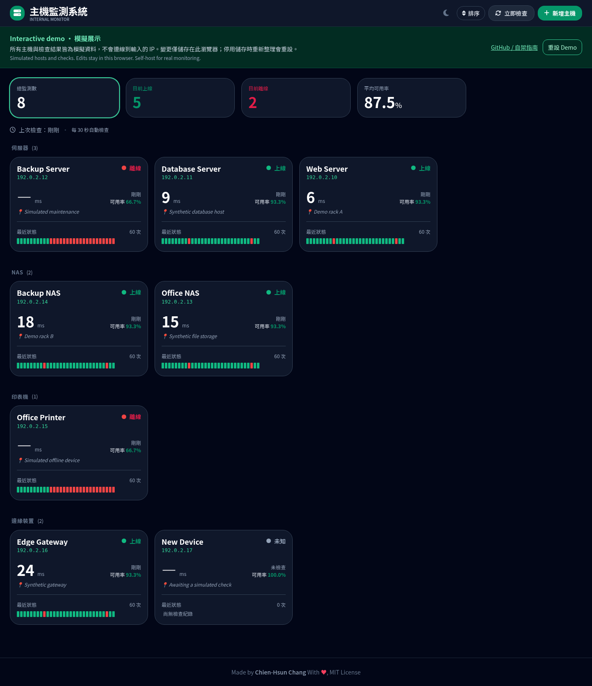

# Host Monitor 主機監測系統

[English](README.md) · [Demo](https://kageryo.github.io/host-monitor/)

輕量、適合自架的 IPv4 主機監測儀表板，可用於伺服器、NAS、印表機與其他設備。後端從部署主機執行 ICMP ping，網頁顯示在線狀態、回應時間、可用率與最近檢查紀錄。

[](LICENSE)
[](https://github.com/KageRyo/host-monitor/releases/latest)
[](https://github.com/KageRyo/host-monitor/actions/workflows/demo-pages.yml)
[](https://sonarcloud.io/dashboard?id=KageRyo_server-monitor)
[](https://nodejs.org/)
[](https://expressjs.com/)
[](#資料與日誌)
[](https://github.com/KageRyo/host-monitor/stargazers)
[](https://github.com/KageRyo/host-monitor/commits)

[](https://kageryo.github.io/host-monitor/)

## 功能概覽

| 功能 | 行為 |
| --- | --- |
| 主機檢查 | 預設每 30 秒 ping，可手動檢查單台或全部主機 |
| 儀表板 | 分類狀態卡片、回應時間、可用率與心跳歷史 |
| 主機管理 | 新增、編輯、刪除 IPv4 目標，設定名稱、類別與備註 |
| 整理與篩選 | 自訂類別順序、只看上線或離線主機 |
| 外觀 | 明暗主題，目前介面為正體中文 |
| 儲存 | 本地 JSON，無需資料庫服務 |
| 離線前端 | 本地生成的 CSS、inline SVG 圖示與系統字型；執行時無需外部 CSS、圖示或字型 CDN |

可用率依累計檢查的成功比例計算；尚未檢查的主機顯示 `—`，全域平均排除這些主機，全部未檢查時也顯示 `—`。每台主機另外保留最近 60 筆歷史。ping 成功表示網路可達，不代表 HTTP 服務或應用程式正常。

## 快速開始

需要 Node.js 18 以上、npm 與可用的系統 `ping` 指令。Bash 啟停腳本另需 `setsid` 及 Linux 程序管理工具；其他平台可在具備相容 ping 工具時使用 `npm start` 前景執行。

```bash
git clone https://github.com/KageRyo/host-monitor.git
cd host-monitor
npm ci --omit=dev --ignore-scripts
npm start
```

開啟 `http://localhost:3000`。首次啟動的主機清單為空，點擊「新增主機」輸入 IPv4 位址、名稱、類別與備註。

Linux 背景執行：

```bash
./start.sh
./stop.sh
```

`start.sh` 顯示本機網址，PID 與程序啟動時間分別儲存於 `logs/server.pid`、`logs/server.identity`；區域網路網址記錄於 `logs/monitor.log`。

腳本送出訊號前會核對程序啟動時間、cwd 與 Node 入口；失效或身分不符的記錄只會清理，不會依名稱搜尋並終止程序。升級舊版前請先透過原本的程序管理方式停止服務；新腳本不會終止缺少身分記錄的舊程序。

## 從檔案匯入目標

可直接在網頁管理主機，或在啟動前準備資料檔：

```bash
mkdir -p data
cp monitors.example.json data/monitors.json
```

將範例位址與名稱改成自己的設備。手動編輯資料檔前先停止服務，修改後重新啟動載入。網頁 API 目前只接受 IPv4，不支援網域名稱或 IPv6。

## 資料驗證與復原

啟動時先驗證完整 JSON 文件，才載入任何主機：IPv4／ID 一致且唯一、文字欄位、狀態與錯誤欄位、非負安全整數計數及與歷史的關係、RTT、時間戳、最多 60 筆合法歷史，以及文字陣列的群組順序。合法舊檔可省略 ID 與選用欄位；ID 依 IPv4 產生，省略的計數依合法歷史推算，群組別名與重複順序照舊正規化。

既有資料格式錯誤、不合法或無法讀取時，會在 HTTP 監聽與排程開始前停止啟動。原檔不會被覆蓋或截斷，並嘗試建立唯一的 `data/monitors.json.corrupt-<timestamp>-<uuid>` 複本；複製失敗會明確記錄，仍停止啟動。只有原檔確實不存在時才使用空清單。復原時請停止服務、保留原檔及封存複本，修正文件或把已確認正常的備份放回 `data/monitors.json`，再啟動。系統不會自動丟棄部分主機或套用未驗證的備份；請另外保留備份，corrupt 複本是可復原來源，不保證可直接使用。

## 環境變數

複製 [.env.example](.env.example) 為 `.env` 即可自訂設定；程序環境變數優先於 `.env`。

| 變數 | 預設值 | 用途 |
| --- | --- | --- |
| `PORT` | `3000` | HTTP 監聽連接埠，範圍 1–65535 |
| `HOST` | `0.0.0.0` | IPv4 綁定位址，無效值會停止啟動 |
| `AUTH_ENABLED` | `false` | 用 HTTP Basic 認證保護 dashboard、靜態資產及所有 API |
| `AUTH_USERNAME` | 空白 | 啟用認證時必填，不能包含冒號 |
| `AUTH_PASSWORD` | 空白 | 啟用認證時必須提供非空白密碼 |
| `CHECK_INTERVAL` | `30000` | 自動檢查間隔，1000–2147483647 毫秒 |
| `LOG_MAX_BYTES` | `5242880` | 日誌輪替門檻，單位為 bytes（5 MiB） |
| `LOG_MAX_FILES` | `5` | 保留的備份數；設為 `0` 時輪替會丟棄舊日誌 |
| `LOG_TO_STDOUT` | 終端機中為 `true`，其餘為 `false` | 是否同時輸出到主控台 |
| `PROBE_CONCURRENCY` | `5` | 自動與手動檢查共用的 ping 並行上限 |
| `MAX_MONITORS` | `100` | 新增主機上限；既有超量資料仍保留並監測 |
| `MANUAL_CHECK_LIMIT` | `10` | 每程序每 60 秒允許的手動檢查請求數，兩個端點共用 |
| `WEBHOOK_ENABLED` | `false` | 啟用通用 JSON webhook |
| `WEBHOOK_INITIAL_DOWN` | `false` | 也通知首次 unknown 轉為 down 的結果 |
| `WEBHOOK_INITIAL_DOWN_THRESHOLD` | `1` | 一次性初始警報所需的連續確認離線次數 |
| `WEBHOOK_URL` | 空白 | HTTP／HTTPS 接收端網址 |
| `WEBHOOK_TIMEOUT_MS` | `5000` | 每次通知的逾時，1–2147483647 毫秒 |

整數設定無效時使用預設值並記錄警告；並行上限、主機上限與手動配額必須是正整數。

範例 `.env` 明確設定 `LOG_TO_STDOUT=false`。後端直接載入 `.env`，無需額外的 dotenv 套件。

## 檢查限制與 API 行為

群組排序模式會顯示所有分類，移動立即生效並儲存完整順序；儲存期間暫停排序控制項，避免重疊操作。polling 會保留編輯中的順序，離開模式維持已儲存順序；儲存失敗會還原最後成功保存的順序並顯示錯誤。

自動與手動檢查共用排程，同一主機不會重疊 ping。全量檢查遇到進行中的單台工作時共用結果；重複單台或全量請求回傳 `429`。手動配額為程序全域固定 60 秒視窗，包含被拒絕的重複請求；超限回傳 `429` 與 `Retry-After`。自動檢查不使用手動配額。新增超過主機上限回傳 `409`，編輯及刪除仍可使用。

新增／更新主機與更新排序必須提供 JSON object；缺少、破損或非物件 body 回傳 `400 { error }`。`stats.avgUptime` 為數字或 `null`；`null` 表示沒有可計算的檢查紀錄，0 仍表示 0%。檢查結果儲存失敗會回復狀態、歷史與計數，該次檢查不納入可用率；成功寫入的結果才觸發通知。內建分類標籤會轉成 `server`、`nas`、`printer`、`edge`，舊資料在載入時正規化，下次成功儲存時寫回。

## Webhook 通知

檢查區分 `up`、`down`、`unknown`（尚未測量）與 `error`（測量執行失敗）。缺少 ping 工具、權限不足、非預期例外、不支援或無法解析的輸出、異常結束碼與 5 秒程序期限都記為 `error`，不當作離線；有效的無回覆／100% 封包遺失結果仍為 `down`。API 提供 `checkError: "probe_execution_failed"` 與 `stats.error`；dashboard 提示檢查監測主機的 ping 與權限，不公開原始程序輸出。錯誤歷史使用 `alive: null`、`rtt: null` 與相同錯誤碼，保留在最近 60 筆歷史中，但不增加 `totalChecks`、`upChecks`，可用率只計算有效結果（尚無有效結果時為 `null`）。錯誤不觸發 webhook；最後確認的可達狀態另外保存，因此錯誤或重啟後首次確認的狀態變化仍能通知。儲存失敗會回復所有先前狀態。

設定 `WEBHOOK_ENABLED=true` 與 `WEBHOOK_URL`，重新啟動後啟用。結果成功儲存後，在 `up→down`、`down→up` 發送通知；首次未知狀態預設不通知。設定 `WEBHOOK_INITIAL_DOWN=true` 可在連續確認離線次數達到 `WEBHOOK_INITIAL_DOWN_THRESHOLD`（正整數，預設 1）後，發送一次初始離線通知。dashboard 仍立即顯示 down，門檻只延後初始通知。沿用 `monitor.status_changed` 事件，payload 使用 `previousStatus: "unknown"` 與 `status: "down"`，`checkedAt` 對應達門檻的檢查。進度跨重啟保留；執行錯誤重設連續計數，儲存失敗則回復計數。首次 up 會結束初始政策，後續一般狀態轉換仍立即通知。首次 up、已通知後持續 down、儲存失敗與 demo 均不通知；已儲存的狀態防止重啟後重複初始警報，已檢查的舊檔主機不補發初始警報。HTTP／HTTPS 接收端收到以下 JSON：

```json
{"event":"monitor.status_changed","monitor":{"id":"192-0-2-1","ip":"192.0.2.1","name":"Router","group":"server"},"previousStatus":"up","status":"down","checkedAt":"2026-10-08T00:00:00.000Z","responseTime":null}
```

通知背景發送，最多 2 個工作與 100 筆等待事件；滿載丟棄新事件並記錄警告。逾時或 HTTP 失敗不阻塞監測、不重試；重啟會丟失等待事件。無效 URL 會停用通知並記錄不含秘密的警告。URL、token 與回應內容不寫入日誌。可設定的連續失敗門檻僅適用於初始離線通知，後續確認的狀態變化立即通知；不提供冷卻或持久化重送。Discord／Slack 請使用接收通用 JSON 的轉接服務。

## 資料與日誌

- `data/monitors.json`：目標、備註、類別順序、累計檢查次數與最近歷史。
- `logs/monitor.log`：應用程式日誌；預設備份為 `monitor.log.1` 至 `monitor.log.5`。
- `logs/startup.log`：透過 `start.sh` 啟動時的輸出。

`data/`、`logs/` 與本地環境檔已加入 `.gitignore`。需要保留設定與累計數據時，請備份 `data/monitors.json`。預設間隔下，60 筆歷史約涵蓋 30 分鐘。

```bash
tail -f logs/monitor.log
```

## 部署

部署主機必須能連到監測目標。為相容既有區域網路部署，預設 `HOST=0.0.0.0` 監聽所有 IPv4 介面，防火牆允許時可存取。使用本機反向代理時，設定 `HOST=127.0.0.1` 可只監聽 loopback，也可指定本機特定 IPv4 位址。不支援主機名稱或 IPv6；無效值會停止啟動，不會改用更廣的綁定範圍。啟動網址符合實際綁定位址，loopback 模式不顯示區域網路網址。綁定位址與請求配額不代表身分驗證；為相容既有部署，認證預設關閉。需要在可信任網路以外存取時，請啟用下述認證或使用有認證的 HTTPS 反向代理。

## 選用身分驗證

在不受版控的 `.env` 設定 `AUTH_ENABLED=true`、`AUTH_USERNAME` 及足夠強且不重複的 `AUTH_PASSWORD` 後重啟。缺少帳密、帳密含控制字元、帳號含冒號或 `AUTH_ENABLED` 無效時會停止啟動。瀏覽器使用原生登入提示，API 客戶端使用 `Authorization: Basic …` 標頭。dashboard、靜態資產與所有讀寫 API（包含 `/api/health`）皆須認證。網址參數不能用來傳入帳密，API 不回傳帳密，認證回應不快取；跨站瀏覽器寫入也會遭拒，避免瀏覽器自動附上的認證被濫用。

Basic 認證只有編碼，沒有加密。遠端存取必須由反向代理提供 HTTPS，並設定 `HOST=127.0.0.1`；不要直接公開 3000 連接埠。例如以 Caddy 為自有網域管理憑證：

```caddyfile
monitor.example.com {
    reverse_proxy 127.0.0.1:3000
}
```

其他代理須保留原始 `Host` 標頭，讓同源操作正常通過。另一種方式是關閉內建認證，讓 HTTPS 代理認證**所有路徑**。例如 Caddy 的 `basic_auth`，搭配 `caddy hash-password` 產生的密碼雜湊：

```caddyfile
monitor.example.com {
    basic_auth {
        operator <generated-password-hash>
    }
    reverse_proxy 127.0.0.1:3000
}
```

部署前請替換範例值；不要把明文密碼放進版控中的代理設定、網址或日誌。公開 GitHub Pages demo 刻意不使用認證，僅操作瀏覽器內的合成資料。內建 Basic 認證只有單一共用帳號，不提供角色、session 或登入暴力嘗試的速率限制；有需要時請搭配代理的存取控制與速率限制。

長期執行可用 [PM2](https://pm2.keymetrics.io/) 直接管理 `server.js`：

```bash
npm install -g pm2
pm2 start server.js --name host-monitor
pm2 save
pm2 startup
```

依 `pm2 startup` 印出的指令完成系統啟動設定。

## 互動 Demo

靜態 demo 沿用現有儀表板，提供八台虛構主機、上線／離線狀態與每 30 秒一次的模擬檢查。可以新增、編輯、刪除主機、手動檢查、排序類別、篩選狀態與切換主題。**不會連線到輸入的位址**，頁面上方有明確的模擬資料提示。

變更以獨立的 localStorage key 保存在訪客瀏覽器，按「重設 Demo」可還原範例。停用瀏覽器儲存時仍可操作，但重新整理會重設。

樣式使用本地生成的 Tailwind CSS，圖示使用 inline SVG，字型使用系統字型。Demo 執行時不需要外部 CSS、圖示或字型 CDN。

在本機建置與預覽 Demo：

```bash
npm install
npm run build:demo
python3 -m http.server 8080 --directory demo-dist
```

開啟 `http://localhost:8080`。自架服務也可透過 `http://localhost:3000/?demo=1` 使用模擬模式；一般網址使用真正的後端 API。

### 發布到 GitHub Pages

[Demo Pages workflow](.github/workflows/demo-pages.yml) 在 PR 中執行測試與建置；推送到 `main` 或在 `main` 手動執行時，只發布產生的前端檔案。

1. 到專案 **Settings → Pages**，將 Source 設為 **GitHub Actions**。
2. 將 demo 變更合併到 `main`；若已合併，可在 **Actions → Demo Pages → Run workflow** 選擇 `main` 手動執行。
3. 部署成功後開啟 [demo](https://kageryo.github.io/host-monitor/)。

網址會在啟用 Pages 且首次部署成功後可用。設定細節見 [GitHub 官方文件](https://docs.github.com/en/pages/getting-started-with-github-pages/using-custom-workflows-with-github-pages)。真正的 ICMP 檢查與 Node.js API 仍需自架後端。

## 開發

後端使用 Express 5 與 `ping` 套件；前端使用 Vanilla JavaScript 與 Tailwind CSS，搭配本地生成的 CSS、inline SVG 圖示與系統字型。執行時不需要外部 CSS、圖示或字型 CDN。

安裝開發依賴：

```bash
npm install
```

修改前端樣式後，重新生成樣式表：

```bash
npm run build:css
```

Demo 建置會先執行 CSS 建置，再將所需前端資產複製到 `demo-dist/`：

```bash
npm run build:demo
```

執行測試並啟動開發伺服器：

```bash
npm test
node --check server.js
npm start
npm run build:css
npm run build:demo
```

`npm test` 使用 Node.js 內建測試工具，分開驗證正式後端、demo、設定、排程、Linux 腳本與 webhook。後端資料寫入臨時目錄，ping 使用 mock，通知使用本機 HTTP receiver，不需真實 ICMP 或外部服務。CI 另執行 `npm run test:browser`，驗證 demo、正式 API 的完整流程與錯誤畫面。

## License

[MIT](LICENSE) © 2026 Chien-Hsun Chang.
